# `arjun@github:~$ whoami`

### Arjun Singh · Systems Engineer & Technical Product Builder

**Computer Science @ RIET Jaipur · Class of 2030**  
Building thoughtful software, systems, and products.

### `arjun@github:~$ ./portrait.sh`

---

### `01 / currently_building`

I like working where **systems thinking meets product craft**: from 3D experiences and client-server architecture to algorithms and AI-assisted workflows.

- 3-time hackathon team lead · Smart India Hackathon internal round, **Top 5**
- Exploring systems engineering, full-stack development, and product design

### `02 / selected_work`

| Project | What it is |
| --- | --- |
| [ASC Archivist](https://github.com/wdymarjun/asc-archivist-backend-3) | Backend systems for a 3D experience, built around decoupled client-server networking. |
| [IndexQuest](https://github.com/wdymarjun/indexquest) | An exploration in building useful, polished software. |
| [Portfolio](https://github.com/wdymarjun/portfolio) | A systems-inspired portfolio, designed and built from scratch. |

### `03 / toolbox`

`JavaScript` · `C++` · `Luau` · `CSS` · `Algorithms` · `Systems Design` · `LLM Workflows`

### `04 / find_me`

Jaipur, India · [Portfolio](https://portfolio-nine-pi-rzvxowcqb1.vercel.app/) · [LinkedIn](https://www.linkedin.com/in/arjun-singh-682453378/) · [Unstop](https://unstop.com/u/arjunsin14938)

---

Designed with intent · shipped one iteration at a time
